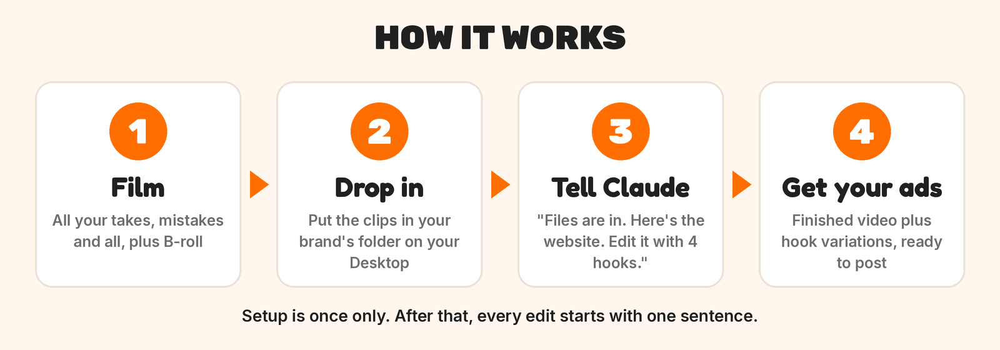
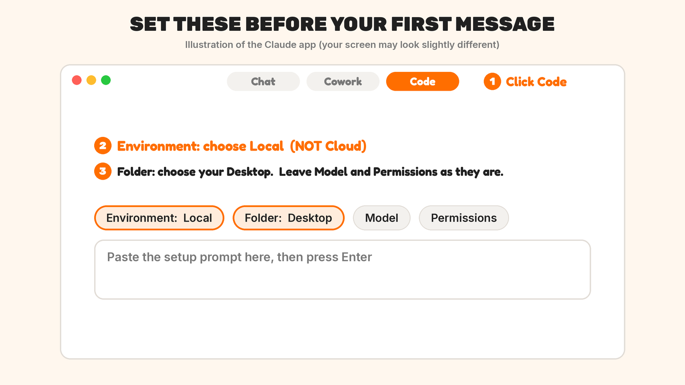
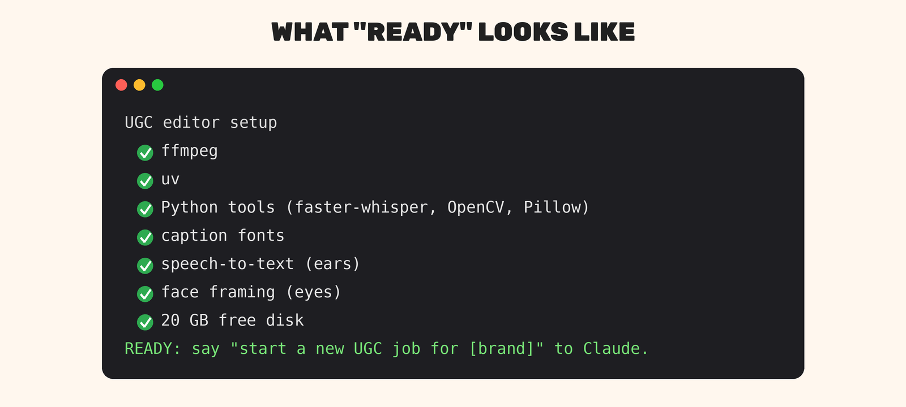
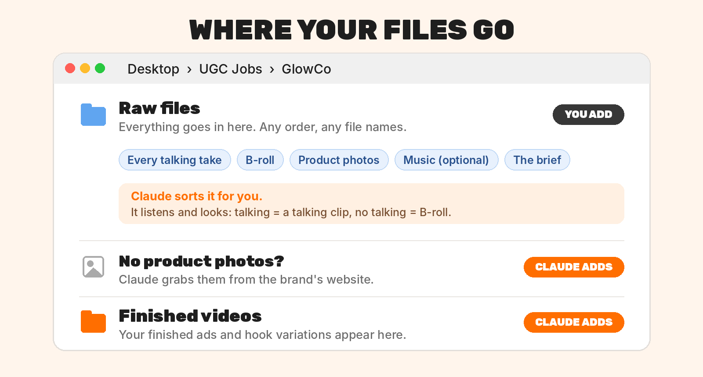

# UGC Editor: how to set it up and use it

Give Claude your raw clips, the brand brief and the brand website. Get back a
finished, captioned ad plus 3-5 hook variations.



## 1. Get Claude on your desktop
- You need a **Mac** and a **paid Claude plan** (Pro or Max).
- Download the app from **claude.ai/download**, open it and sign in.
- Click the **Code** tab. Above the message box, set **Environment** to **Local**
  (not Cloud), and pick your **Desktop** as the folder.



## 2. Give Claude the editor
Copy this, paste it into Claude and press Enter:

```
Install the UGC editor for me from https://github.com/HiveHubollective/ugc-editor
Put it in ~/.claude/skills/ugc-editor and run its scripts/setup.sh. Fix anything
that isn't ticked and run it again until it says READY. Then make a folder called
"UGC Jobs" on my Desktop. Explain each step in plain English, and tell me before
anything asks for my password.
```

Click **Allow** whenever Claude asks. If a Mac pop-up asks to install developer
tools, click **Install**. Claude may ask for your Mac password once to install its
tools: type it (nothing shows as you type) and press Enter. Done when you see
**READY**. You only do this once.



## 3. Your UGC Jobs folder



Say **"Start a new UGC job for [brand]"**. Claude makes a folder for that brand
inside **UGC Jobs** on your Desktop, with two folders in it:

| Folder | What goes in it |
|---|---|
| **Raw files** | everything: every talking take (mistakes and all), B-roll, product photos, a music track if you want one, the brief. Any order, any file names. |
| **Finished videos** | your finished edits appear here |

AirDrop your clips from your phone and drag them all into **Raw files**. You don't
sort anything: Claude listens to every clip and works out which are talking clips
and which are B-roll. No product photos? Claude grabs them from the brand's website.
You can also paste the brief into the chat instead.

## 4. Ask for the edit, then changes
```
Files are in. Here's the website: [link]. Edit it with 4 hook variations.
```
Then watch every version with sound on and ask for changes in normal words:
"use a different take for the hook", "cut the line about X", "the B-roll comes in
too early", "make clean versions too" (no captions or text, to finish in CapCut).

When Claude fixes something, it asks if it should add it to its rules. Say yes:
that's how it learns your taste, so the next edit needs fewer notes. Your rules are
saved in **UGC Jobs → My editing rules.md** on your Desktop. Open it any time to read
or change them. They apply to every job from then on, and updating the editor never
touches them.

Start a **new chat for each new job**. The editor and your rules carry over to every
chat. To go back to an older job, open its chat from the sidebar, or start a new one
and say "carry on with the [brand] job".

**Updating:** the editor doesn't update itself. When we release improvements, say
"update the UGC editor" and Claude downloads the latest version. Your rules stay as
they are.

**Better footage, better ad:** write your hook before you film. Claude can cut and
polish, but it can't add a hook you never said.

---

**Stuck?** Tell Claude what happened in plain words and paste any error. It can
fix most things itself.
